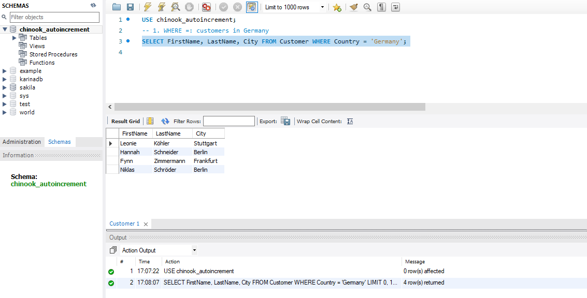
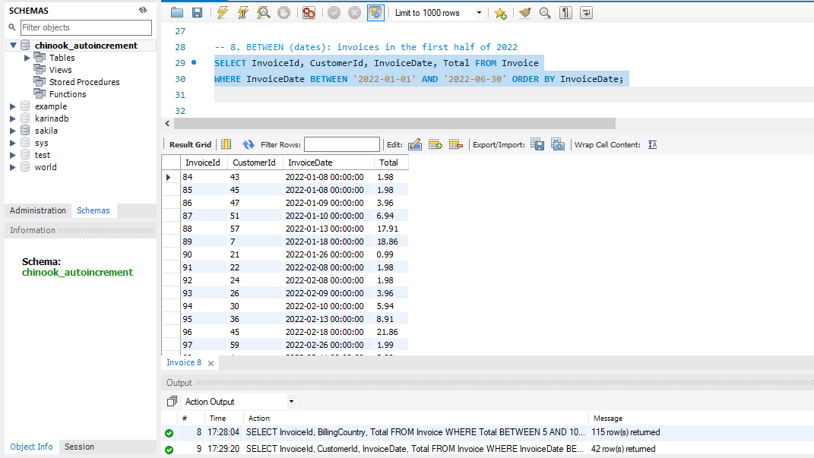
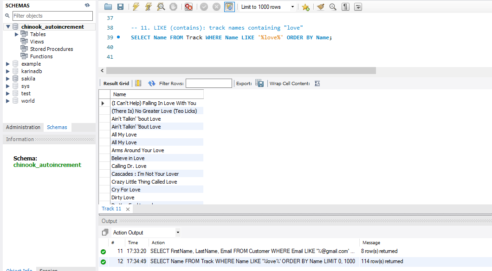

# SQL Filtering Practice (Chinook Database, MySQL)

## Overview
12 SQL queries that practice filtering with WHERE, IN, BETWEEN and LIKE on the Chinook
sample database (a digital music store) in MySQL Workbench.

## Files
- veda_queries2.sql: all 12 queries
- outputs/: screenshot of each query result (query1.png to query12.png)

## Setup
- Database: Chinook (Chinook_MySql_AutoIncrementPKs.sql, version 1.4.5)
- Tool: MySQL Workbench with MySQL 8.0
- I used the Chinook database, which I had already set up in MySQL, instead of Northwind.

## Queries and results
| # | What it does | Filter used | Rows returned |
|---|---|---|---|
| 1 | Customers in Germany | WHERE = | 4 |
| 2 | Employees who are not Sales Support Agents | WHERE <> | 5 |
| 3 | Tracks over 10 minutes priced 0.99 | WHERE with AND | 49 |
| 4 | Customers in France or Germany | WHERE with OR | 9 |
| 5 | Customers in the UK, Ireland, Portugal or Spain | IN | 7 |
| 6 | Countries other than USA, Canada and Brazil | NOT IN | 21 |
| 7 | Invoices with a total from 5 to 10 | BETWEEN (numbers) | 115 |
| 8 | Invoices in the first half of 2022 | BETWEEN (dates) | 42 |
| 9 | Customers whose last name starts with S | LIKE 'S%' | 8 |
| 10 | Customers with a Gmail address | LIKE '%@gmail.com' | 8 |
| 11 | Track names containing "love" | LIKE '%love%' | 114 |
| 12 | Customers with no company | IS NULL | 49 |

## Sample outputs
Query 1 (WHERE =)

Query 8 (BETWEEN with dates)

Query 11 (LIKE)

The screenshots of all 12 queries are in the [outputs folder](outputs).

## What I learned
- = looks for an exact match, while LIKE looks for a pattern (% means any text, _ means one character)
- BETWEEN includes both end values and is useful for number and date ranges
- IN is a shorter way to write several OR conditions
- IS NULL is used to find missing values (= NULL does not work)
